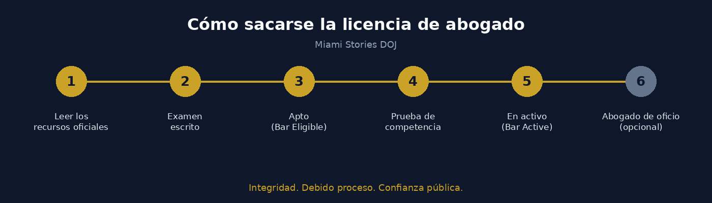

# Miami Stories DOJ

### portal de justicia de mi servidor de GTA RP

Esta es la web que hice para el Departamento de Justicia (DOJ) de **Miami Stories**, un servidor de roleplay de GTA V. Sirve para que la gente pida abogado, mire el docket (la lista pública de casos y juicios) o se saque la licencia de abogado sin tener que preguntar todo por Discord. Está subida a Cloudflare Pages (por eso la URL acaba en `pages.dev`) y se entra con la cuenta de Discord, con el botón *Login with Discord*.

Web: [miami-stories-doj.pages.dev](https://miami-stories-doj.pages.dev/)

## Qué se puede pedir

- un abogado (defensa)
- demandas civiles
- órdenes de arresto, aunque eso solo lo piden policía y fiscales
- certificados de matrimonio y divorcio

| Petición | Quién la hace | Notas |
|---|---|---|
| Defense Counsel Request (pedir abogado) | cualquier ciudadano | también para cuando estás en celda |
| Warrant Request (orden de arresto) | policía / fiscalía | la revisa un juez |
| Expungement Request (borrar antecedentes) | ciudadano o su abogado | hay que cumplir requisitos antes |

## Sacarse la licencia de abogado

En la web se llama "Bar", que en EE. UU. es el colegio de abogados. Sin estar en el Bar no puedes llevar casos.



1. Leerse los recursos oficiales
2. Examen escrito
3. Prueba de competencia

Con el examen aprobado pasas a *Bar Eligible* (apto, pero todavía sin poder ejercer) y con la prueba a *Bar Active* (ya puedes llevar casos). Lo de Public Defender, que es el abogado de oficio, va aparte y es opcional.

Lo de las divisiones y cómo funciona el tema de los jueces está en [docs/detalles.md](docs/detalles.md).

Si lo quieres en local:

```
git clone https://github.com/albeen-sknight/actividad-markdown.git
cd actividad-markdown
```

#### Hecho en clase

Esta documentación la he hecho para la asignatura de Implantación de Aplicaciones Web, en el IES Clara del Rey.


foto de ANAGSPC, CC BY-SA 4.0, vía [Wikimedia Commons](https://commons.wikimedia.org/wiki/File:I.e.s._clara_del_rey_(Prosperidad,_Madrid).jpg)

- [ ] poner una captura del docket
